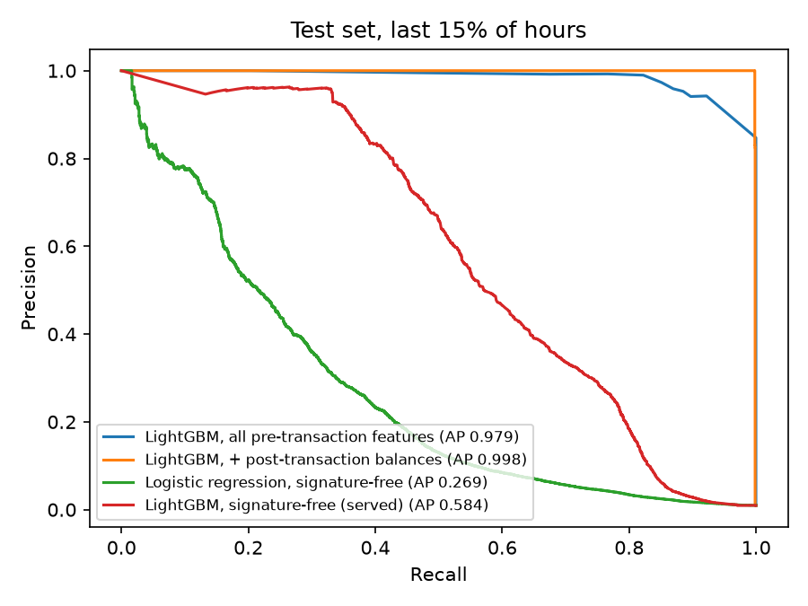

# Fraud Detection on PaySim: What's Left When You Remove the Shortcut

A fraud model for mobile-money transfers: time-ordered evaluation, a threshold
chosen by cost, per-prediction explanations, a FastAPI scoring service and a
drift check.

The main result is a correction. **PaySim, the usual dataset for this task,
can be solved with one equality check**, so the 0.99 scores reported on it
measure the simulator, not fraud detection. With that shortcut removed, the
honest number is **0.58 PR-AUC**.

## Results

Test set: the last 15% of transactions by time (hours 378–743, 408k
transfers and cash-outs, 4,010 frauds). The threshold is picked on validation
data, never on test.

| Model | PR-AUC | Alerts | Precision | Recall | Fraud amount caught |
|---|---|---|---|---|---|
| PaySim's built-in rule (transfer > 200k) | 0.013 | 13 | 100.0% | 0.3% | 1.1% |
| **One line: `amount == oldbalanceOrg`** | **0.975** | 3,909 | 100.0% | 97.5% | 84.2% |
| LightGBM, all pre-transaction features (1 tree) | 0.979 | 4,732 | 84.7% | 100.0% | 100.0% |
| LightGBM, + post-transaction balances | 0.998 | 3,952 | 100.0% | 98.6% | 96.3% |
| Logistic regression, signature-free | 0.269 | 10,581 | 17.3% | 45.7% | 63.8% |
| **LightGBM, signature-free (served)** | **0.584** | 9,455 | 30.9% | 72.9% | 95.0% |



## What the first model actually learned

The first LightGBM scored 0.98 using only information available before the
transaction runs. It looked like a strong result, but the saved model had
**one tree**.

That tree had learned a quirk of the simulator. PaySim's fraudster always
moves the account's exact balance:

| | Fraud | Legitimate |
|---|---|---|
| `amount == oldbalanceOrg` | 97.8% | 0.00% |

So a one-line rule reaches 0.975, and every feature that exposes the origin
balance lets a model rediscover that rule. Real fraud doesn't follow a rule
this tidy. The served model therefore leaves out the origin balance entirely
(`SIGNATURE_FREE` in [`fraud/features.py`](fraud/features.py)), and 0.58 is
what fraud signal remains in the other features.

The post-transaction balances are a separate leak: a payment system can't see
them when it has to decide. They are trained only to show the size of that
gap and are never served.

## Other things the data showed

- **Fraud volume is flat over time; legitimate volume isn't.** About 550 frauds
  per 50 hours throughout, while transfer and cash-out volume falls from ~370k per 50 hours to
  under 45k after hour 450. The fraud rate goes from 0.19% in training to 1.0% in test.
  A random split hides this; a time split exposes it.
- **More model capacity doesn't help.** With 63-leaf trees, validation AP peaks
  within ten trees and then falls from 0.40 to 0.24 as the model memorises
  hour-specific patterns. 15-leaf trees reach the same ~0.59 test AP and stay
  there from 100 to 600 trees, so the result doesn't hinge on when early
  stopping fires.
- **Fraud only occurs in `TRANSFER` and `CASH_OUT`.** The other three types are
  approved without scoring rather than given a meaningless score.

## The threshold is a cost decision

A missed fraud costs its amount; a false alarm costs one analyst review. The
threshold minimises total cost on validation data, using an exact search over
every distinct score rather than a grid
([`fraud/metrics.py`](fraud/metrics.py)). How it moves with the review cost:

| Review cost | Alerts | Precision | Recall | Fraud amount caught |
|---|---|---|---|---|
| 100 | 130,133 | 2.8% | 90.1% | 98.9% |
| 1,000 | 11,474 | 26.7% | 76.5% | 96.9% |
| **10,000 (default)** | 9,455 | 30.9% | 72.9% | 95.0% |
| 100,000 | 2,570 | 72.0% | 46.1% | 83.7% |

Recall by count understates the result: the model catches 95% of the fraud
*amount* because large frauds tend to score higher than small ones.

## Serving

```bash
uvicorn app:app
```

```http
POST /score
{"type": "TRANSFER", "amount": 850000, "oldbalanceOrg": 850000,
 "oldbalanceDest": 0, "step": 400, "dest_prior_txns": 0}
```

```json
{
  "score": 0.0085,
  "decision": "approve",
  "threshold": 0.0097,
  "reasons": [
    {"feature": "log_dest_balance", "contribution": 2.4938},
    {"feature": "log_amount", "contribution": 1.2926},
    {"feature": "hour", "contribution": -1.2164}
  ]
}
```

This transaction drains the account exactly, which is the simulator's
signature. The served model approves it anyway, because it was built not to
see the origin balance.

- **Reasons** are exact TreeSHAP values from LightGBM's own `pred_contrib`, in
  log-odds; no extra explanation library.
- **One feature implementation.** The API calls the same `features.build` as
  training, so serving and training features can't drift apart.
- **`POST /score/batch`** for many transactions, **`POST /drift`** for the PSI
  of a batch against a training sample (>0.25 is flagged), and **`GET /health`**.

Drift from training to test is low for every served feature except `hour`
(PSI 0.104, in the "watch" band), which reflects the volume collapse above.

## Run it

```bash
python -m venv .venv && .venv\Scripts\activate   # Python 3.14
pip install -r requirements.txt
python -m fraud.train      # downloads PaySim (178 MB) on first run; ~5 min
pytest                     # 5 tests: no-leak history feature, exact threshold, PSI, API
uvicorn app:app
```

PaySim is loaded with tight dtypes and integer account ids (~300 MB instead
of ~2.5 GB), so the full 6.3M rows train on a 4 GB laptop.

## Layout

| File | |
|---|---|
| [`fraud/features.py`](fraud/features.py) | Feature sets; destination history counted from earlier hours only |
| [`fraud/metrics.py`](fraud/metrics.py) | Exact cost-minimising threshold, PSI |
| [`fraud/train.py`](fraud/train.py) | Time split, baselines, models, sweep, artefacts |
| [`app.py`](app.py) | FastAPI service |
| [`tests/test_core.py`](tests/test_core.py) | Leak, threshold (against brute force), drift and API tests |

## Limits

- **PaySim is synthetic.** The main lesson here is about the dataset; the 0.58
  is the honest number *for PaySim*, not a claim about real payments.
- **`dest_prior_txns` is supplied by the caller.** In production it would come
  from a feature store.
- **The review cost is a flat assumption.** That's why the sweep is shown
  rather than a single number.

The widely used Kaggle credit-card dataset (ULB) was left out on purpose: its
features are anonymised PCA components (V1–V28), which leaves nothing to
engineer or explain.
